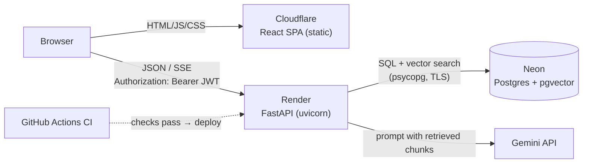
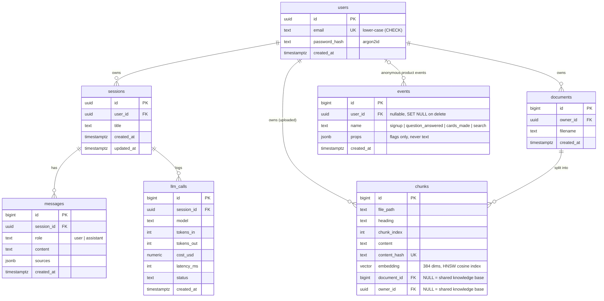
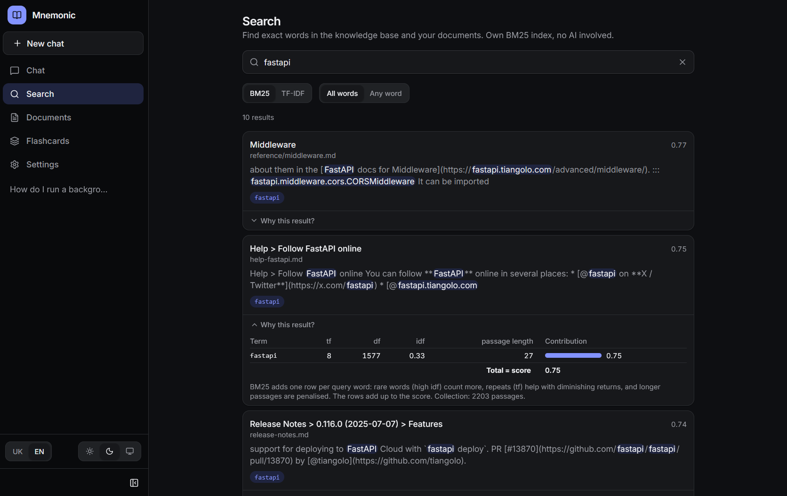
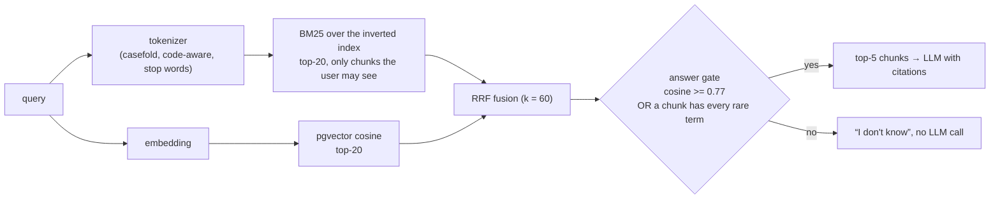

# Mnemonic

**Ask your notes. Get cited answers. Remember them.** An AI study assistant: pick a ready knowledge base or upload
your own files, ask questions, and get answers that cite their sources (or honestly say "I don't know"), then turn
them into flashcards.

[](.github/workflows/ci.yml)

## Live

- **App (SPA):** TODO_STUDENT: paste the live Cloudflare URL here (the page you open is the landing page; "Try it" leads to sign-up).
- **API:** https://mnemonic-y1js.onrender.com · [docs](https://mnemonic-y1js.onrender.com/docs) · [health](https://mnemonic-y1js.onrender.com/health)
- The API runs on Render's free plan and sleeps after 15 minutes idle: the first request can take up to a minute
  (the app shows a "server is waking up" banner with a timer).

## Demo

- TODO_STUDENT: link to the 60-second demo video (landing → sign-up → first cited answer → "Make flashcards").
- TODO_STUDENT: live screenshots: `docs/screenshots/landing.png`, `docs/screenshots/chat.png` (take them on the deployed site, then embed them here).

## Who it is for and the problem

**For** students and self-learners with a pile of material (lecture notes, PDFs, documentation) who need to understand
and remember it, not just search it.

**The problem it solves**

- Reading everything takes too long, and plain search finds words, not answers.
- A generic chatbot invents answers and does not show where they came from.
- Turning material into flashcards by hand is slow.

**The one thing it does:** you ask, the answer streams in with clickable citations (or "not in your materials"), and
one click makes flashcards from it. The main action we measure is *"asked a question and got a cited answer"*.
First-time flow: open the site → "Try it" → register → three example questions about the ready FastAPI knowledge base
are one tap away. More: [docs/PRODUCT.md](docs/PRODUCT.md).

## Features

- **Accounts.** Register with email + password (stored as an argon2id hash), log in for a 24 h JWT, send it as
  `Authorization: Bearer`. Every data endpoint scopes rows to the user in the token; someone else's id answers 404.
- **Chat sessions (the CRUD resource).** Create, list (paginated), get, rename, delete; chat history per session.
- **Questions over documents (RAG).** Answers stream in (SSE) and cite their sources; an off-topic question gets
  "I don't know" without calling the LLM. Click a citation to read the exact chunk (`GET /chunks/{id}`).
- **My documents.** Upload `.md`, `.txt` or text PDFs (<= 5 MB, <= 50 pages, <= 5 files per account); questions
  search the shared FastAPI docs plus your own files only.
- **Flashcards.** An answer becomes 3–5 question/answer cards (structured LLM output validated by Pydantic).
- **Calculator tool.** With Gemini the model can call a calculator (`ast`-parsed, no `eval`).
- **Conversation memory:** the last 3 question/answer pairs go into the prompt.
- **Landing page and onboarding (lab 34).** A public front page at `/` (one sentence, one "Try it" button, a mock of a cited
  answer, 3 steps, privacy note); after sign-up the chat opens with the knowledge base ready and three tap-to-ask example
  questions, plus a one-time hint pointing to "Make flashcards".
- **Graceful failures.** Offline banner with retry, "server is waking up" banner, 429 countdown, cut-off streams, weird
  input: [docs/labs/lab-34-failures.md](docs/labs/lab-34-failures.md).
- **One tracked metric.** Server-side events and an owner-only `GET /admin/stats`: [ADR 0006](docs/decisions/0006-capstone-metrics.md).
- **Telegram bot.** The same RAG, citations and flashcards in a chat app: [Telegram bot](#telegram-bot), [ADR 0007](docs/decisions/0007-telegram-client.md).

## Tech stack

| Layer | Choice |
|---|---|
| API | Python 3.13, FastAPI 0.165, Pydantic 2.14, uvicorn 0.54, managed with `uv` |
| Auth | pwdlib 0.4 (argon2id), PyJWT 2.15 (HS256) |
| Database | PostgreSQL 17 + pgvector (Neon), psycopg 3.3 (raw SQL, no ORM), Alembic 1.20 migrations |
| AI | fastembed 0.9 (`BAAI/bge-small-en-v1.5`, ONNX on CPU), Gemini via google-genai 3.6 (or a fake provider) |
| SPA | React 19.3, TypeScript 7.0, Vite 8.3, TanStack Query 5, Tailwind 4, i18next (uk / en) |
| Quality | ruff, pytest (unit + real-Postgres integration), vitest, oxlint, GitHub Actions |
| Hosting | API on Render (free), SPA on Cloudflare, database on Neon |

## Architecture



One request, end to end: the SPA sends `POST /sessions` with the Bearer token → FastAPI's `get_current_user`
dependency verifies the JWT signature and expiry and loads the user → the route calls `PgStore.create_session`
in a worker thread → one parameterised `INSERT ... RETURNING` → the row comes back as JSON with `201 Created`.

## What is "AI" about it

Nothing is trained or fine-tuned: the AI parts are two pre-trained models, retrieval we wrote ourselves, and the
guardrails around them.

| Part | What | Where |
|---|---|---|
| **LLM** | Gemini (default `gemini-3.5-flash-lite`, chosen by `GEMINI_MODEL`) behind one `LLMProvider` interface; a fake provider is used in tests and CI | [backend/src/mnemonic/llm/](backend/src/mnemonic/llm/), [ADR 0002](docs/decisions/0002-gemini-model-choice.md) |
| **Embeddings** | `BAAI/bge-small-en-v1.5` (384 dims) run locally with fastembed / ONNX on CPU | [ADR 0001](docs/decisions/0001-fastembed-over-sentence-transformers.md) |
| **Prompts** | `SYSTEM_PROMPT` (answer only from the context, cite chunk ids, say "I don't know", treat context as data, never as instructions), `FLASHCARD_PROMPT`, the calculator `TOOL_NOTE` | [backend/src/mnemonic/rag.py](backend/src/mnemonic/rag.py) |
| **Retrieval** | pgvector cosine top-20 + our own positional inverted index with BM25 top-20, merged by Reciprocal Rank Fusion; top-5 go to the LLM | [ADR 0005](docs/decisions/0005-hybrid-retrieval.md), [search/](backend/src/mnemonic/search/) |
| **Data** | The shared knowledge base is the FastAPI documentation (MIT, 2203 chunks); users add their own `.md` / `.txt` / text PDFs | [docs/labs/lab-31.md](docs/labs/lab-31.md) |

**Guardrails that make the answers checkable**

- *"I don't know" without calling the LLM*: if the best chunk is not similar enough (and no chunk contains every rare
  query word), the app refuses and spends nothing.
- *Citations are verified*: only ids of chunks that were really retrieved reach the client; each opens the exact passage.
- *Prompt-injection hardening*: uploaded text is wrapped in tagged blocks, cannot close its own tag, and the prompt says
  the context is data. Flashcards use structured output validated by Pydantic.
- *A calculator tool* (parsed with `ast`, no `eval`) for arithmetic over numbers in the context.

### Quality numbers

| What | Result | Source |
|---|---|---|
| Retrieval hit (7 on-topic questions, live service, 2026-11-20) | 7/7 | [eval/results.md](eval/results.md) |
| Answer keywords found | 93 % | same |
| Honest "I don't know" on off-domain questions | 3/3 | same |
| Short keyword queries answered (10), vector only vs hybrid | 6/10 vs **10/10** | [docs/labs/lab-15-eval.md](docs/labs/lab-15-eval.md) |
| Off-topic questions refused (10), hybrid | 10/10 | same |

These are smoke tests (10 and 27 questions), not benchmarks; the limits are written down in the *Eval* section below.

### Eval

A small regression check of the whole pipeline (retrieval → LLM → citations → "I don't know").

**Method.** [eval/eval.json](eval/eval.json) has 10 questions about the FastAPI docs: 7 on-topic (each with
an `expected_file` and 2 `keywords`, taken from the real chunks) and 3 off-domain (Django, a recipe, sports).
[eval/run_eval.py](eval/run_eval.py) calls the running server over HTTP, a fresh session per question, and
pauses between LLM calls so the service-wide `GLOBAL_RPM` budget is not exceeded (on 429 it waits
`Retry-After` and retries once).

```powershell
$env:EVAL_EMAIL = "<email>"; $env:EVAL_PASSWORD = "<password>"; $env:BASE_URL = "http://localhost:8000"; $env:GLOBAL_RPM = "5"
python eval/run_eval.py     # standard library only; writes eval/results.md
```

**Metrics** (plain string checks, no LLM judge):

- *Retrieval hit* — `expected_file` is among the `sources` of the answer.
- *Keywords* — share of the expected keywords found in the answer text (case-insensitive).
- *IDK correctness* — an off-domain question gets "I don't know" and an empty `sources`.

**Results** (2026-11-19, local server, real Gemini + Neon, `gemini-3.5-flash-lite`):

| metric | score |
|---|---|
| Retrieval hit | 6/7 |
| Answer keywords | 93% |
| IDK correctness (off-domain) | 3/3 |

The one retrieval miss (background tasks): the model cited `reference/background.md` instead of
`tutorial/background-tasks.md`. Both are relevant, so this is partly a strict-metric artefact.
A second run against the live service (2026-11-20, same model): retrieval hit 7/7, keywords 93%, IDK 3/3.
Full table: [eval/results.md](eval/results.md).

**Honest limitations.**

- Only 10 questions: one question is 10 percentage points, so differences are noise-level. This is a smoke test, not a benchmark.
- No LLM judge: keywords only show that the answer mentions the right terms, not that it is correct.
- `sources` contains only the chunks the model *cited*, so "retrieval hit" mixes retrieval quality and citing behaviour.
- The similarity threshold (0.77) was calibrated on 8 questions; the margin to the nearest off-domain score is ~0.03.
  The off-domain questions here are different from the calibration ones, but still few and easy.
- One run, one model, non-deterministic LLM output: a re-run can differ.

### Benchmark: RAG vs plain LLM

[eval/run_benchmark.py](eval/run_benchmark.py) asks the same 10 questions twice with the same model: through the
running server (RAG) and directly through the backend's provider with no retrieval and no system prompt (plain).

```powershell
$env:EVAL_EMAIL = "<email>"; $env:EVAL_PASSWORD = "<password>"; $env:BASE_URL = "http://localhost:8000"; $env:GLOBAL_RPM = "5"
uv run --project backend python eval/run_benchmark.py     # writes eval/benchmark.md
```

Results (2026-11-20, `gemini-3.5-flash-lite`, full table in [eval/benchmark.md](eval/benchmark.md)):

| metric | RAG | plain LLM |
|---|---|---|
| Keywords found, on-topic (7 q) | 93% | 100% |
| Honest refusal, off-domain (3 q) | 3/3 | 0/3 |
| On-topic answers with source links | 7/7 | 0/7 (none by design) |
| False refusals, on-topic | 0/7 | 0/7 |

**What it shows and what it does not.** RAG gives checkable sources and stays in scope; it did *not* beat the
plain model on keywords, probably because the model knows the public FastAPI docs from training. So this is
not proof that "RAG is better". Limits: 10 questions, one run, keywords do not measure correctness, and the
plain-model "refusal" is a crude substring match on a short phrase list (it misses refusals worded differently
and can fire on normal answers); for off-domain questions an ordinary assistant answering is not a bug.

## What real users said

TODO_STUDENT: after watching at least 3 real users (not family): what they did, what surprised you, what you changed.
Notes go to `docs/user-feedback/session1..3.md` and `docs/user-feedback/iterations.md`, a summary goes here.

Usage numbers (signups, questions answered, main-action rate) come from the owner-only `GET /admin/stats`
([ADR 0006](docs/decisions/0006-capstone-metrics.md)): TODO_STUDENT: paste the real numbers after the first users.

## Cost per user

How it is measured: every LLM call writes a row to `llm_calls` (tokens in / out, `cost_usd`, latency, status). With
`PRICE_IN_PER_M` / `PRICE_OUT_PER_M` set to the provider's prices, `cost_usd` is real; `GET /admin/stats` returns
`llm_cost.avg_per_active_user_usd` = all LLM cost ÷ users who got at least one answer.

- **Today: $0.** The app runs on the Gemini free tier (prices are 0, so the log records 0) and free tiers of Render and
  Neon. The limits are the real cost: `GLOBAL_RPM` (5 LLM calls per minute for the whole service) and a per-IP limit.
- **Shape of the cost** (an *assumption* to be checked against `/admin/stats`, not a measurement): one question is one
  LLM call (a calculator round adds one more), about 2 000 input tokens (system prompt + 5 chunks + recent history) and
  400 output tokens; flashcards are one more call. At a hypothetical $0.10 / $0.40 per million tokens that is about
  $0.0004 per question, so 30 questions a user a month is roughly **$0.01–0.02 per user per month**. Refusals cost
  nothing: no LLM call.
- TODO_STUDENT: replace the assumption with the real `avg_per_active_user_usd` from `/admin/stats` once real users exist,
  and set a hard billing limit at the provider.

## Telegram bot

A second client of the same backend ([ADR 0007](docs/decisions/0007-telegram-client.md)): send a question to the bot and
get the same cited answer (or the honest "not in your materials"), then `/cards` for flashcards. It calls the same
functions as the web routes, so limits, citations and events are identical.

| Message | What happens |
|---|---|
| plain text | a question: the answer plus a **Sources** list (`[1] heading — path`), or the "I don't know" refusal as is |
| `/start` | a 2-line welcome and the three example questions as buttons (the same as the web) |
| `/cards` | up to 5 flashcards ("Q / A") for the last answered question |
| `/new` | a fresh chat (the bot forgets this conversation) |
| `/help` | the list above |
| photo, voice, sticker | "text questions only" |

It is optional: without `TELEGRAM_BOT_TOKEN` the app runs exactly as before and the webhook route is a 404.

**Create and connect it**

1. In Telegram open [@BotFather](https://t.me/BotFather), send `/newbot`, pick a name and a username ending in `bot`. Copy the token.
2. Make a webhook secret: `uv run python -c "import secrets; print(secrets.token_urlsafe(32))"` (from `backend/`).
3. Set three variables on the backend (Render: Environment; locally in `backend/.env`):
   `TELEGRAM_BOT_TOKEN`, `TELEGRAM_WEBHOOK_SECRET`, `PUBLIC_URL` (the service's own https address).
   On start the app calls Telegram's `setWebhook` with `PUBLIC_URL/telegram/webhook/<secret>` and the same secret as the
   `X-Telegram-Bot-Api-Secret-Token`; a failure is only logged. Restart or redeploy to (re-)register.
4. Optional: build the SPA with `VITE_TELEGRAM_BOT_URL=https://t.me/<your_bot_username>` to show an "Open in Telegram" link
   on the landing page (hero and footer). Unset = hidden.
5. Telegram cannot reach `localhost`: locally use any https tunnel for `PUBLIC_URL`, or rely on the unit tests (they never call Telegram).

**Limitations (honest)**

- **One shared knowledge base**: the bot has no way to upload files; a Telegram user only sees the shared FastAPI docs.
- **Text only**: no photos, voice or files; private chats only (groups are ignored).
- **Free-tier cold start**: after a sleep the first reply can take up to a minute (Telegram retries, duplicates are dropped).
- A Telegram account has no web login by design (its password is a hash of an unknown secret); deleting it is an owner action
  on the `users` row (the cascade removes the chats).
- Telegram itself carries the questions, then Gemini sees them as on the web.

## Run locally

Needs Python 3.13 + [uv](https://docs.astral.sh/uv/), Node 22, and a Postgres with pgvector (a free Neon branch
works). Details: [docs/SETUP.md](docs/SETUP.md).

```powershell
# backend
cd backend
Copy-Item .env.example .env        # fill in DATABASE_URL and JWT_SECRET (LLM_PROVIDER=fake needs no key)
uv sync
uv run alembic upgrade head        # build the schema
uv run python -m mnemonic.ingest   # optional: the shared FastAPI-docs knowledge base
uv run fastapi dev src/mnemonic/main.py   # http://127.0.0.1:8000/docs

# frontend (second terminal)
cd frontend
Copy-Item .env.example .env        # VITE_API_URL = the backend above or the deployed one
npm ci
npm run dev                        # checks VITE_API_URL first (same as `npm run doctor`)
```

Every variable is documented in [backend/.env.example](backend/.env.example) (no real values in the repo).
`JWT_SECRET` must be at least 32 characters: `uv run python -c "import secrets; print(secrets.token_urlsafe(48))"`.

Tests: `uv run pytest` (unit; integration tests skip themselves) and, against a **throwaway** database,
`$env:TEST_DATABASE_URL = "postgresql://..."; uv run pytest -m integration` (see [backend/README.md](backend/README.md#tests)).

## Deploy

**CI** ([.github/workflows/ci.yml](.github/workflows/ci.yml)) runs on every push / PR to `main` and `lab-21`:

- `backend`: a `pgvector/pgvector:pg17` service container, `uv sync`, `ruff check`, `ruff format --check`,
  `pytest` (unit + integration on that real database; fake LLM, no model download, dummy `JWT_SECRET`).
- `frontend`: `npm ci`, `tsc -b`, `oxlint`, `npm run test` (vitest), `npm run build`.

**CD**: the API is a Render Blueprint ([render.yaml](render.yaml)) with `autoDeployTrigger: checksPass`: a commit
on `main` deploys only after its CI checks pass, so a red test blocks the deploy.

1. Render dashboard → **New +** → **Blueprint** → this repo (or, for an existing service, set
   **Settings → Auto-Deploy → After CI checks pass**).
2. Environment variables (service → **Environment**; never in the repo):

   | Variable | Value |
   |---|---|
   | `DATABASE_URL` | Neon connection string (`...?sslmode=require`) |
   | `JWT_SECRET` | signs the tokens, >= 32 random characters; the app refuses to start without it |
   | `REGISTRATION_CODE` | optional: an invitation code; empty = open registration |
   | `LLM_PROVIDER` / `GEMINI_API_KEY` / `GEMINI_MODEL` | `gemini`, the key (server-side only), model name |
   | `CORS_ORIGINS` | the SPA's URL, e.g. `https://<your-spa>.workers.dev` |

   Render asks for `sync: false` variables only when a Blueprint is first created; on an existing one add new
   keys (e.g. `JWT_SECRET`) by hand.
3. Migrations: the start command runs `alembic upgrade head` before uvicorn, so a deploy applies new revisions
   first; if one fails, the new instance never becomes healthy and Render keeps the old one live.
4. Health check: `GET /health` (no auth, no database).
5. SPA: see [frontend/README.md](frontend/README.md) (Cloudflare; `VITE_API_URL` at build time).

### Deploy notes: memory and the embedding model

#### Memory (free tier = 512 MB)

- Embeddings run **locally on the server** with fastembed (ONNX, no PyTorch), model `BAAI/bge-small-en-v1.5`
  (see [ADR 0001](docs/decisions/0001-fastembed-over-sentence-transformers.md)).
- Measured locally: ~120 MB after importing the app, ~250 MB with the model loaded, peak ~280 MB.
  Check the real number in Render → **Metrics** → Memory after a few questions.
- The model is loaded lazily, on the first question.

#### Where the embedding model lives

fastembed caches models in the system temp dir by default (`/tmp/fastembed_cache`), which Render does **not**
keep between deploys/restarts — every cold start would download ~65 MB before the first answer.
So the build command downloads the model into `backend/.cache/fastembed` (the project directory, which is kept
from build to run; the folder is git-ignored) and `FASTEMBED_CACHE_PATH` points there.
Result: no download at runtime, the first question only pays the ~1 s model load.

### Deployment checklist (lab 21 brief)

- [ ] API live at a public URL — the lab-21 code is not deployed yet (`TODO_LIVE_URL`).
- [x] OpenAPI / Swagger UI at `/docs` (in code; live once deployed).
- [x] `curl` examples in this README, including auth.
- [x] Secrets (DB URL, JWT secret) only in environment variables, not in code.
- [x] `.env` (every variant) is in `.gitignore`; the git history was searched for secrets: none found.
- [x] Passwords hashed with argon2id.
- [x] Wrong password returns 401 (tested).
- [x] A request to a protected endpoint without a token returns 401 (a test walks every route).
- [ ] One user can't access another user's data — covered by tests and `scripts/ownership_smoke.py` on the
  dev database; to verify manually on the live URL after the deploy.
- [x] JSON responses with `Content-Type: application/json`.
- [x] CORS configured: an explicit list of SPA origins (`CORS_ORIGINS`), no credentials.
- [ ] The deployed `/health` returns 200 — after the deploy.

## Side quests done

- **Rate limiting**: per-IP sliding window (10/min), stricter on `/auth/*` (5/min), and a service-wide LLM budget;
  `429` + `Retry-After`.
- **Pagination**: `GET /sessions?limit=&offset=` with `total` and `next`, stable order (`updated_at DESC, id`).
- **Structured JSON logs**: one line per request (method, route template, status, duration, user id, ip; never
  headers, bodies or tokens).
- **Automated tests**: ~190 unit tests (fakes, no DB), integration tests on real Postgres + pgvector (migrations up/down,
  races, cascades, ownership, one HTTP flow), vitest for the SSE parser.
- **CI/CD**: GitHub Actions on every push / PR; Render deploys only after checks pass.
- Extension: a React SPA with login / register, server-side chat sessions, uk / en ([frontend/](frontend/)).
- **Localization (lab 34 side quest):** the whole UI incl. the landing page in Ukrainian and English, switchable and remembered.
- **Eval / benchmark:** a 10-question regression eval, a RAG-vs-plain-LLM benchmark and a retrieval ablation (see *Eval* below).
- **Cost awareness:** per-call cost log and an owner-only stats endpoint with cost per active user (real numbers pending).
- **Own analytics, no third parties:** [ADR 0006](docs/decisions/0006-capstone-metrics.md).

## Honest limitations

- **No refresh token and no revocation.** A token is valid for 24 h; logout only forgets it on the client. A stolen
  token works until it expires (deleting the account does stop it: the user is looked up on every request).
- **The token lives in localStorage**: readable by any script on the SPA's page if there is ever an XSS bug.
  An HttpOnly cookie was rejected: the SPA and the API are different origins (SameSite / CSRF complexity).
- **Rate limiters are in memory**: they reset on every restart / deploy and are per instance (two instances = double
  the limit). Fine for one free instance; Redis would be the fix.
- **Register answers 409 for a taken email**, so someone can check whether an email has an account (login does not
  leak this: same 401 and a dummy hash for unknown emails).
- **Registration is open** unless `REGISTRATION_CODE` is set; the per-IP limit is the only other brake.
- **Flashcard decks are stored in the browser only** (localStorage, per user): not synced between devices.
- **Render free plan cold start**: ~30–60 s for the first request after 15 minutes idle.
- **Multipart is parsed before the auth check** on `POST /documents` (the framework reads the form first).
- **English-only embedder**; short one- or two-word questions may fall under the similarity threshold.
- **The calculator only works after retrieval passes** (the "I don't know" gate runs first).
- **The knowledge base and the embedder are English.** The example questions are English on purpose; a question in
  Ukrainian may be refused because its embedding does not match the English chunks. The UI is fully localized.
- **No real-user evidence yet.** The metric and the feedback write-up exist as machinery; the numbers come after the
  first users (lab 34, M3).
- **Link previews are English only.** The `og:` tags are static in `index.html` (crawlers do not run JavaScript).
- **Event counts start at the deploy of migration `0004`** and are per registered user; there are no page-view counts.
- **The landing page and the failure banners were verified with unit tests of the markup and the timer logic, not
  yet in real browsers on real devices** (see [docs/labs/lab-34.md](docs/labs/lab-34.md)).
- Failure behaviour (offline, cold start, 429, cut streams, weird input): [docs/labs/lab-34-failures.md](docs/labs/lab-34-failures.md).

## Privacy and ethics

- **What we store:** your email and an argon2id password hash; your chats, uploaded documents and their chunks (all
  private to your account); and anonymous product events (`signup`, `question_answered`, `cards_made`, `search`, with
  flags like "was it cited"). **Never the text of a question in an event.** There are no cookies and no third-party
  analytics or scripts.
- **What leaves our servers:** each question, the passages found for it and the last few messages are sent to Google's
  Gemini API to write the answer. Do not upload confidential, personal or someone else's copyrighted material. Free
  tiers of AI providers may use inputs to improve their products: check the provider's terms before real use.
- **Your control:** *Settings → Delete account* removes the account with all its chats, documents and chunks; event rows
  stay as anonymous counts (the link to you is cut).
- **AI can be wrong.** That is why every answer cites its sources and the app says "I don't know" instead of guessing:
  open the citation and check. Flashcards are generated from those same passages and can still contain mistakes.
- It is a study aid, not a source of medical, legal or financial advice.

## Team

Solo project (42-Lab program): one developer did everything; code was written with an AI assistant and every line is defended by the developer.

## Reference

### Database (ER diagram)



Foreign keys are `ON DELETE CASCADE`: deleting an account (`DELETE /auth/me`) removes its sessions,
messages, LLM call log, documents and chunks (`events.user_id` is set to NULL instead: the anonymous counts stay). Shared knowledge-base chunks (`owner_id IS NULL`) belong to nobody.
The schema is owned by Alembic: [backend/migrations/versions/](backend/migrations/versions/) (raw SQL).

### Try the API with curl

Swagger UI at `/docs` has an **Authorize** button (username = email). From a terminal:

**bash** (uses `jq`):

```bash
API=https://mnemonic-y1js.onrender.com

# register (201), then log in with the OAuth2 password form (username = email)
curl -s -X POST "$API/auth/register" -H "Content-Type: application/json" \
  -d '{"email": "alice@example.com", "password": "correct horse battery"}'
TOKEN=$(curl -s -X POST "$API/auth/login" \
  --data-urlencode "username=alice@example.com" --data-urlencode "password=correct horse battery" \
  | jq -r .access_token)
AUTH="Authorization: Bearer $TOKEN"

curl -i "$API/sessions"                                   # no token -> 401
SID=$(curl -s -X POST "$API/sessions" -H "$AUTH" -H "Content-Type: application/json" \
  -d '{"title": "FastAPI basics"}' | jq -r .id)           # create -> 201
curl -s "$API/sessions?limit=10&offset=0" -H "$AUTH"      # list -> {items, total, limit, offset, next}
curl -s "$API/sessions/$SID" -H "$AUTH"                   # get
curl -s -X PATCH "$API/sessions/$SID" -H "$AUTH" -H "Content-Type: application/json" \
  -d '{"title": "Dependency injection"}'                  # rename
curl -i -X DELETE "$API/sessions/$SID" -H "$AUTH"         # delete -> 204
```

**PowerShell 7** (`curl.exe`, not the `curl` alias):

```powershell
$API = "https://mnemonic-y1js.onrender.com"

curl.exe -s -X POST "$API/auth/register" -H "Content-Type: application/json" `
  -d '{"email": "alice@example.com", "password": "correct horse battery"}'
$TOKEN = (curl.exe -s -X POST "$API/auth/login" `
  --data-urlencode "username=alice@example.com" --data-urlencode "password=correct horse battery" |
  ConvertFrom-Json).access_token
$AUTH = "Authorization: Bearer $TOKEN"

curl.exe -i "$API/sessions"                                # no token -> 401
$SID = (curl.exe -s -X POST "$API/sessions" -H $AUTH -H "Content-Type: application/json" `
  -d '{"title": "FastAPI basics"}' | ConvertFrom-Json).id  # create -> 201
curl.exe -s "$API/sessions?limit=10&offset=0" -H $AUTH     # list
curl.exe -s "$API/sessions/$SID" -H $AUTH                  # get
curl.exe -s -X PATCH "$API/sessions/$SID" -H $AUTH -H "Content-Type: application/json" `
  -d '{"title": "Dependency injection"}'                   # rename
curl.exe -i -X DELETE "$API/sessions/$SID" -H $AUTH        # delete -> 204
```

All endpoints: [backend/README.md](backend/README.md#endpoints).

#### Status codes

| Code | When |
|---|---|
| 200 | read / update / login succeeded |
| 201 | created: account, session, document |
| 204 | deleted: session, document, account |
| 401 | no token, bad / expired token, or wrong email / password (same answer for both: no user enumeration) |
| 403 | wrong or missing registration code (only if `REGISTRATION_CODE` is set) |
| 404 | does not exist **or is someone else's** (403 would confirm that the id exists) |
| 409 | email already registered; document limit reached |
| 413 | upload too large |
| 422 | validation error (Pydantic): bad email, short password, unsupported file, ... |
| 429 | rate limit (per IP, stricter on `/auth/*`, or the service-wide LLM budget); see `Retry-After` |
| 502 | the LLM failed or returned an invalid format (`/flashcards`) |

### Search

Keyword search over the knowledge base and your own documents, built by hand (lab 15): a **positional inverted
index** (`term → {chunk → positions}`) ranked with **BM25** (TF-IDF is kept as a baseline), pure Python standard
library, in [backend/src/mnemonic/search/](backend/src/mnemonic/search/). It does two jobs:

- **`GET /search`** and the SPA **Search** screen: ranked chunks, a snippet with highlighted words, matched-term
  chips, and a **"Why this result?"** table (tf, df, idf, contribution per query word) from `GET /search/explain`.
- **Hybrid retrieval in the chat**: the BM25 top-20 is fused with the pgvector top-20 by Reciprocal Rank Fusion, and
  a lexical "I don't know" gate lets short keyword questions (`CORS`, `Depends`) through. Decision record:
  [docs/decisions/0005-hybrid-retrieval.md](docs/decisions/0005-hybrid-retrieval.md).



<!-- TODO: save a screenshot of the Search screen (query "Depends", one "Why this result?" open) as docs/screenshots/search.png -->



`GET /search` itself uses only the BM25 half (no embedding, no LLM, so it costs nothing and answers in a few ms).

#### Numbers

| What | Value |
|---|---|
| Corpus A: FastAPI docs as 159 files (`search_cli.py --bench`) | build 3.4 s, 12 110 terms, 1.43 MB as JSON |
| Query latency on corpus A (20 queries) | `mode=all` p50 1.1 ms / p95 4.3 ms · `mode=any` p50 0.7 ms / p95 2.7 ms |
| Corpus B: 2203 chunks in the app (startup build, ADR 0005) | build about 2.5 s, about 27 MB of Python objects (`tracemalloc`) |
| Render memory before / after the index | *fill in after the deploy (startup log line + Render Metrics)* |

Reproduce: `cd backend; uv run python scripts/search_cli.py --bench`. Windows laptop numbers, not Render's.

Retrieval ablation on corpus B (retrieval only, no LLM; details in [docs/labs/lab-15-eval.md](docs/labs/lab-15-eval.md)):

| config | original questions (7) | short keyword queries answered (10) | off-topic refused (10) | `python` alone |
|---|---|---|---|---|
| vector only (the old behaviour) | 7/7 | 6/10 | 10/10 | refused |
| BM25 only | 6/7 | 10/10 | 10/10 | answered |
| hybrid, gate a (cosine only) | 7/7 | 6/10 | 10/10 | refused |
| hybrid, gate b (any full lexical match) | 7/7 | 10/10 | 10/10 | answered |
| **hybrid, gate c (chosen)** | **7/7** | **10/10** | **10/10** | refused |

#### Lexical vs semantic

| | Lexical (BM25) | Semantic (embeddings) |
|---|---|---|
| Wins on | exact identifiers and rare words: `CORS`, `Depends`, `response_model` | paraphrase: "run something after I send the response" finds *background tasks* |
| Fails on | no shared words, plurals (no stemming), synonyms | one-word queries (weak embedding), exact strings |
| Cost | a dict lookup, a few ms, about 27 MB for 2203 chunks, nothing to train | a model in RAM, one embedding per query, a vector index |
| Explainable | yes: every score is a sum of per-term numbers (the "why" table) | no: one cosine number |

Neither is enough alone (BM25 alone missed 1 of 7 original questions; vector alone answered 6 of 10 keyword
queries), so the chat uses both and RRF merges the two ranked lists without calibrating their scores.

#### Try it with curl

```bash
# $API and $AUTH as in "Try the API with curl" above
curl -s "$API/search?q=Depends&limit=3" -H "$AUTH" | jq '.[0]'
curl -s -G "$API/search" --data-urlencode 'q="dependency injection"' -d ranker=tfidf -d mode=all -H "$AUTH"
curl -s -G "$API/search/explain" --data-urlencode 'q=Depends' -d chunk_id=42 -H "$AUTH" | jq    # chunk_id from /search
```

```powershell
curl.exe -s "$API/search?q=Depends&limit=3" -H "Authorization: Bearer $TOKEN"
curl.exe -s -G "$API/search/explain" --data-urlencode "q=Depends" -d chunk_id=42 -H "Authorization: Bearer $TOKEN"
```

Query syntax: `foo bar` (all words), `"exact phrase"`, `-excluded`; `mode=any` needs one word only. A search hit
returns `snippet.text` plus `snippet.highlights` as `[start, end)` offsets in Unicode **code points**: the SPA converts
them itself and renders `<mark>` elements, never HTML. Live check after a deploy:
`uv run python scripts/search_smoke.py <API URL>`.

#### Limitations (honest)

- **The "I don't know" gate is tuned on one corpus.** A term counts as rare if it is in at most 10 % of all chunks. That
  number was chosen on the FastAPI docs (2203 chunks, 968 of them release notes) with the same small query set used to
  pick it, so the evaluation is optimistic. On a tiny personal corpus (a few chunks) no term is below 10 %, so the
  lexical gate almost never fires and the chat behaves like vector-only.
- **English stop words only, no stemming**: `middlewares` does not match `middleware`; common Ukrainian words are
  indexed like any other word, so Ukrainian notes are searchable but noisier.
- **The index lives in the memory of one process** and is rebuilt on every restart (about 2.5 s here); until it is ready
  `/search` answers 503 with `Retry-After` and the chat falls back to vector-only. Several workers would each keep their
  own copy and miss each other's uploads.
- **`python` alone is refused by design** (it is in 17 % of the chunks, so it proves nothing); the same holds for other
  very common words.
- The latency and memory numbers come from a developer laptop; the Render numbers are filled in after the deploy.
