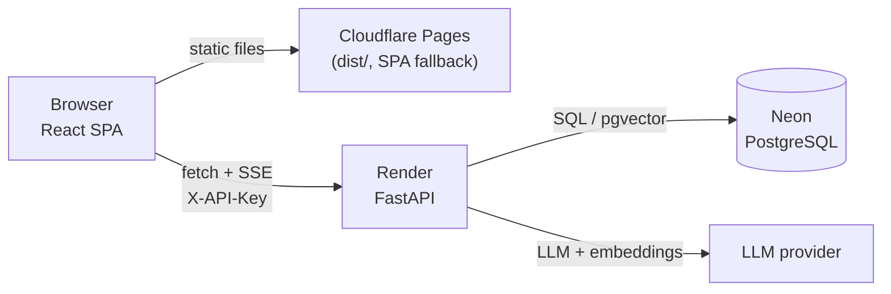

# Mnemonic — frontend

A study assistant in the browser: ask questions about a knowledge base or your own notes, get answers you can verify (every claim links to the exact passage it came from), and turn answers into flashcards.

- **Live:** TODO_LIVE_URL
- **Recording (60 s: enter code → ask → open a source → upload → delete):** TODO developer

## What makes it mine: verifiable answers

Answers stream in token by token. Inline **citation chips** `[1]` in the text scroll to and highlight the matching **source card**; a card opens the **exact chunk** the model was given (`GET /chunks/{id}`), rendered as markdown, with its match percentage. If the knowledge base has nothing, the answer says so in a distinct "Not in the knowledge base" block instead of guessing. Design: Linear-style minimal, one indigo accent, Inter, light and dark (CSS-variable tokens in `src/styles/tokens.css`).

## Tech stack

| | |
|---|---|
| Language / build | TypeScript 7.0, Vite 8.3 (`@vitejs/plugin-react` 6.3) |
| UI | React 19.3, Tailwind CSS 4.3, Radix Dialog 1.3, lucide-react 1.77, sonner 2.0 |
| Routing | react-router-dom 7.18 |
| Server state | TanStack Query 5.108 |
| Forms | react-hook-form 7.92 + zod 4.6 |
| i18n | i18next 27 + react-i18next 18 (uk / en) |
| Markdown | react-markdown 10 (renders model output as React elements, ignores raw HTML) |
| Lint | oxlint 1.94 |

## Architecture



The SPA never talks to the database or the LLM. It only knows `VITE_API_URL`; the backend allows the SPA origin through `CORS_ORIGINS`.

## Run locally

```powershell
cd frontend
npm install
cp .env.example .env        # fill in the values below
npm run dev                 # http://localhost:5173
npm run build ; npm run lint
```

`.env.example`:

| Variable | Meaning |
|---|---|
| `VITE_API_URL` | Backend base URL, no trailing slash. The only place the API address comes from. |
| `VITE_MAX_UPLOAD_MB` | Client-side upload limit (the server enforces its own). |
| `VITE_SITE_URL` | Public URL of this site, used to build the absolute `og:image` link. Empty is fine locally. |

`VITE_*` values are baked in at build time: change one, rebuild/redeploy. `.env` is git-ignored.
`npm run dev` first prints the effective API URL and warns if it is missing or local. `npm run smoke` checks the backend as the SPA sees it (CORS preflight, 401 on a wrong key, 200 on a right one) and needs `SMOKE_KEY`.

## Deploy (Cloudflare Pages)

1. Push the repo to GitHub.
2. Cloudflare → **Workers & Pages** → **Create** → **Pages** → **Connect to Git** → pick the repo.
3. Root directory `frontend`, build command `npm run build`, output directory `dist`.
4. Environment variables: `VITE_API_URL` = the Render URL, `VITE_SITE_URL` = the Pages URL, `NODE_VERSION` = `22`.
5. Deploy, copy the URL.
6. Render → backend → Environment → `CORS_ORIGINS` = that URL (comma-separated if several) → save (it redeploys).
7. Open the URL, enter the access code, ask a question.

Deep links like `/documents` work because `public/_redirects` contains `/* /index.html 200` (the SPA fallback).
Link previews: `public/og.png` (1200×630, regenerated with `node scripts/gen-og.mjs`) plus OpenGraph/Twitter tags in `index.html`.

## Side quests done

- **i18n** (uk / en): every UI string in `src/i18n/*.json`; the `<html lang>`, page titles and date formats follow the language.
- **Optimistic delete** with rollback on failure (documents).
- **Offline banner** and graceful failure everywhere: unreachable server refuses entry, retry buttons on failed loads, SSE errors and aborts handled.
- Also: route-level code splitting, lazy markdown, dark/light without flash, `prefers-reduced-motion`.

## Known limitations

- **The access code lives in `localStorage`.** Any script running on the page (XSS) can read it: the same class of risk as a JWT in `localStorage`. Mitigations here: model output is rendered without raw HTML, no third-party scripts. An `httpOnly` cookie would be the fix, and it needs a real backend session.
- **No real accounts until lab 21.** The "login" is a shared access code; `owner_id` and `session_id` are random UUIDs in `localStorage` that only separate one browser's data from another's. **`owner_id` is not auth**: anyone who learns a UUID can use it.
- **The SSE parser (`src/api/sse.ts`) has no unit tests yet.** It is the most fragile piece (split chunks, split UTF-8). Tests and CI come in lab 21.
- Flashcard decks are stored only in this browser.
- Tested by hand, no automated UI tests.

## Layout

- `src/styles/tokens.css` — design tokens, the only place with colours.
- `src/api/` — `client.ts` (`X-API-Key`, 401/403 handling, typed errors), `sse.ts` (stream parser), `chat.ts`, `documents.ts`.
- `src/features/` — chat (streaming, citations, source cards), documents, flashcards.
- `src/pages/` — one lazy-loaded file per route.
- `src/i18n/` — `uk.json`, `en.json`.

## Credentials

There is no demo account: the app uses a single access code. Ask the author for it.
