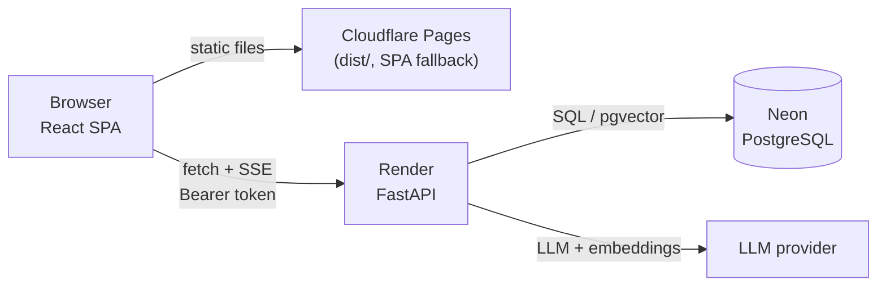

# Mnemonic — frontend

A study assistant in the browser: ask questions about a knowledge base or your own notes, get answers you can verify (every claim links to the exact passage it came from), and turn answers into flashcards.

- **Live:** TODO_LIVE_URL
- **Recording (60 s: sign up → ask → open a source → upload → delete):** TODO developer

## What makes it mine: verifiable answers

Answers stream in token by token. Inline **citation chips** `[1]` in the text scroll to and highlight the matching **source card**; a card opens the **exact chunk** the model was given (`GET /chunks/{id}`), rendered as markdown, with its match percentage. If the knowledge base has nothing, the answer says so in a distinct "Not in the knowledge base" block instead of guessing. Design: Linear-style minimal, one indigo accent, Inter, light and dark (CSS-variable tokens in `src/styles/tokens.css`).

## Tech stack

| | |
|---|---|
| Language / build | TypeScript 7.0, Vite 8.3 (`@vitejs/plugin-react` 6.3) |
| UI | React 19.3, Tailwind CSS 4.3, Radix Dialog 1.3, lucide-react 1.77, sonner 2.0 |
| Routing | react-router-dom 7.18 |
| Server state | TanStack Query 5.108 |
| Forms | react-hook-form 7.92 + zod 4.6 |
| i18n | i18next 27 + react-i18next 18 (uk / en) |
| Markdown | react-markdown 10 (renders model output as React elements, ignores raw HTML) |
| Lint | oxlint 1.94 |

## Architecture



The SPA never talks to the database or the LLM. It only knows `VITE_API_URL`; the backend allows the SPA origin through `CORS_ORIGINS`.

## Run locally

```powershell
cd frontend
npm install
cp .env.example .env        # fill in the values below
npm run dev                 # http://localhost:5173
npm run build ; npm run lint
```

`.env.example`:

| Variable | Meaning |
|---|---|
| `VITE_API_URL` | Backend base URL, no trailing slash. The only place the API address comes from. |
| `VITE_MAX_UPLOAD_MB` | Client-side upload limit (the server enforces its own). |
| `VITE_SITE_URL` | Public URL of this site, used to build the absolute `og:image` link. Empty is fine locally. |

`VITE_*` values are baked in at build time: change one, rebuild/redeploy. `.env` is git-ignored.
`npm run dev` first prints the effective API URL and warns if it is missing or local. `npm run smoke` checks a running backend as the SPA sees it: CORS preflight with `Authorization`, register a random user + login, `GET /sessions` 200 with the token and 401 without, then deletes the user. Env: `SMOKE_ORIGIN` (the SPA origin, default `http://localhost:5173`), `SMOKE_API` (default `VITE_API_URL`), `SMOKE_INVITE` (only if the server needs an invitation code). It makes 2 calls to the rate-limited auth endpoints (limit 5/min per IP).

## Deploy (Cloudflare Pages)

1. Push the repo to GitHub.
2. Cloudflare → **Workers & Pages** → **Create** → **Pages** → **Connect to Git** → pick the repo.
3. Root directory `frontend`, build command `npm run build`, output directory `dist`.
4. Environment variables: `VITE_API_URL` = the Render URL, `VITE_SITE_URL` = the Pages URL, `NODE_VERSION` = `22`.
5. Deploy, copy the URL.
6. Render → backend → Environment → `CORS_ORIGINS` = that URL (comma-separated if several) → save (it redeploys).
7. Open the URL, create an account (invitation code if the server sets `REGISTRATION_CODE`), ask a question.

Deep links like `/documents` work because `public/_redirects` contains `/* /index.html 200` (the SPA fallback).
Link previews: `public/og.png` (1200×630, regenerated with `node scripts/gen-og.mjs`) plus OpenGraph/Twitter tags in `index.html`.

## Side quests done

- **i18n** (uk / en): every UI string in `src/i18n/*.json`; the `<html lang>`, page titles and date formats follow the language.
- **Optimistic delete** with rollback on failure (documents, chats), optimistic inline rename.
- **Offline banner** and graceful failure everywhere: a stored token is trusted only after the server confirms it (an unreachable server shows a retry, not a logout), retry buttons on failed loads, SSE errors and aborts handled.
- Also: route-level code splitting, lazy markdown, dark/light without flash, `prefers-reduced-motion`.

## Auth flow

1. `/register` (email, password 8–128 chars, optional invitation code) → `POST /auth/register`, then the same login as below.
2. `/login` → `POST /auth/login` as `application/x-www-form-urlencoded` (`username` = the email; the server uses the OAuth2 password form, so Swagger's **Authorize** works too). The JWT (24 h) goes to `localStorage["mnemonic.token"]`.
3. `api/client.ts` adds `Authorization: Bearer <token>` to every call. On any **401** (an SSE request included) it removes the token and calls the injected `onAuthFailure`; the auth provider answers by clearing the caches and `RequireAuth` redirects to `/login`, remembering the page you wanted. The client itself knows nothing about React.
4. On load a stored token is checked with `GET /auth/me` (TanStack Query, skeleton while waiting). 401 → login; a network error → "retry", the token is kept.
5. Login and logout **clear the whole query cache** (and the chunk cache), so one account never sees another's data.
6. Settings: the email, **Sign out** (forget the token) and **Delete account** (`DELETE /auth/me`, then this user's decks and the token are removed, and you land on `/register`).

Chats come from the server: the sidebar lists `GET /sessions` (first page, "Load more" follows `next`), *New chat* is `POST /sessions` (the server makes the id and the first-question title), rename is `PATCH`, delete is `DELETE`. `/chat/:sessionId` opens one; a 404 shows "chat not found" and drops it from the list.

## Known limitations

- **The token lives in `localStorage`.** Any script running on the page (XSS) can read it and use the account for up to 24 h. Mitigations: model output is rendered without raw HTML, no third-party scripts. An `httpOnly` cookie would be safer, but the SPA (Cloudflare) and the API (Render) are different origins, which brings SameSite/CSRF complexity. Accepted trade-off, see ADR 0004.
- **No refresh token and no server-side revocation.** After 24 h the API answers 401 and you sign in again; "Sign out" only forgets the token on this device.
- **Flashcard decks are stored only in this browser** (`mnemonic.decks.<userId>`): they do not follow you to another device. Deleting the account removes them from this browser.
- **The SSE parser (`src/api/sse.ts`) has no unit tests yet.** It is the most fragile piece (split chunks, split UTF-8). Tests and CI come in lab 21 M4.
- Tested by hand, no automated UI tests.

## Troubleshooting

| Symptom | Meaning |
|---|---|
| **401** on a data call, then the login page | The token is missing or expired (24 h). Sign in again. A 401 on the login form itself means a wrong email or password. |
| **403** on register | The server needs an invitation code (`REGISTRATION_CODE`) and the field was empty or wrong. |
| **409** on register | That email already has an account. |
| **429** on login/register | At most 5 attempts per minute per IP. Wait a minute. |
| CORS error / "Can't reach the server" | The SPA origin is not in the backend's `CORS_ORIGINS`, or `VITE_API_URL` points to the wrong place. Run `npm run smoke`: its first step shows which. |

## Layout

- `src/styles/tokens.css` — design tokens, the only place with colours.
- `src/api/` — `client.ts` (Bearer token, 401 handling, typed errors), `auth.ts`, `sessions.ts`, `sse.ts` (stream parser), `chat.ts`, `documents.ts`.
- `src/features/` — chat (streaming, citations, source cards), documents, flashcards.
- `src/pages/` — one lazy-loaded file per route.
- `src/i18n/` — `uk.json`, `en.json`.

## Credentials

There is no demo account: register one on `/register`. If the server is closed behind an invitation code, ask the author for it.
